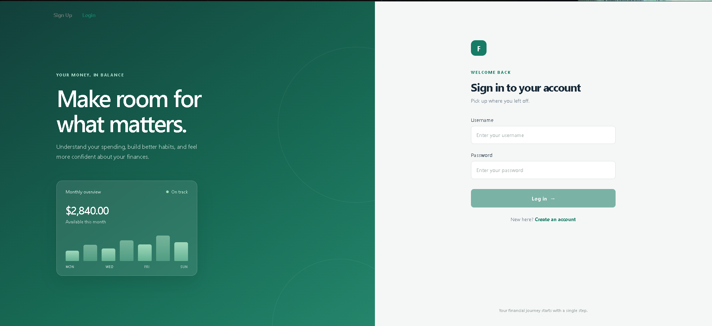
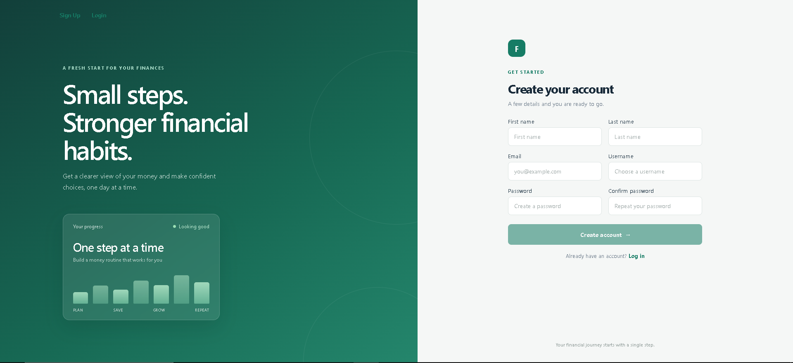
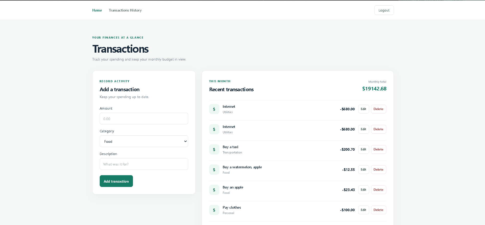
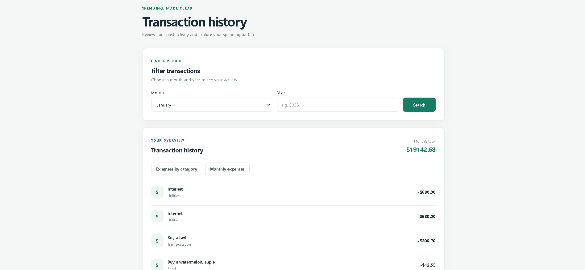
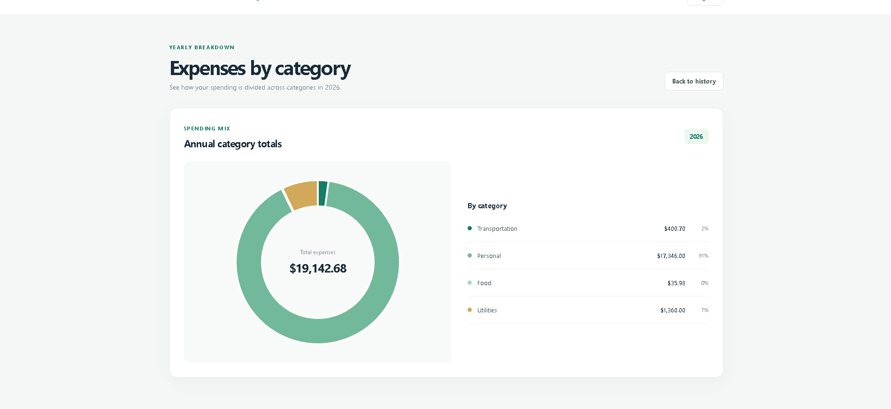
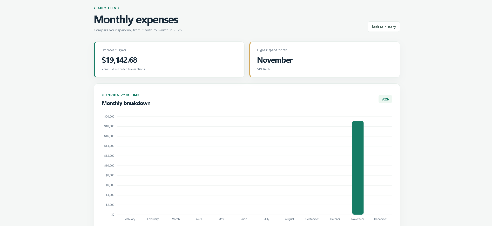

# Personal Finance App







## About

Personal Finance App helps users record and review their expenses. Users can create an account, sign in, manage transactions, and view simple expense charts.

The project has two parts:

- **Frontend:** React and Vite.
- **Backend:** Flask, SQLAlchemy, and MySQL.

## Main Features

- Create an account and sign in.
- Add, edit, and delete transactions.
- Choose a category for each transaction.
- View a monthly transaction total.
- Browse transactions with pages.
- Filter transaction history by month and year.
- View expenses by category or month with charts.

## How It Works

The React app sends requests to the Flask API. The API checks the request and reads or saves data in the MySQL database.

The API uses a JWT cookie for login. The frontend uses the login state to show the public pages or the private pages.

The transaction list uses server-side pagination. By default, it asks for 10 transactions at a time.

## Main Pages

| Page | URL | Purpose |
|---|---|---|
| Sign up | `/signup` | Create a user account. |
| Login | `/login` | Sign in to an account. |
| Transactions | `/home-transaction` | Add and manage transactions. |
| Transaction history | `/history` | Filter and review transactions. |
| Expenses by month | `/bymonth?year=2026` | View monthly expenses for a year. |
| Expenses by category | `/bycategory?year=2026` | Compare expenses by category. |

## API Overview

The main API routes are:

| Method | Route | Purpose |
|---|---|---|
| `POST` | `/api/users/register` | Create a user. |
| `POST` | `/api/users/login` | Sign in and set the login cookie. |
| `POST` | `/api/users/logout` | Clear the login cookie. |
| `GET` | `/api/transactions?page=1&per_page=10` | Get a page of transactions. |
| `GET` | `/api/transactions?month=2026-01` | Get transactions for a month. |
| `POST` | `/api/add/transactions` | Add a transaction. |
| `PUT` | `/api/update/transactions/<id>` | Update a transaction. |
| `DELETE` | `/api/delete/transactions/<id>` | Delete a transaction. |
| `GET` | `/api/transactions/stats/by-category?year=2026` | Get yearly totals by category. |
| `GET` | `/api/transactions/stats/by-month?year=2026` | Get totals for each month of a year. |

## Project Structure

```text
backend/
  app/
    factory.py
    models/
    routes/
    validators/
  config_db.py
  requirements.txt
  run.py

frontend/
  app/
    src/
      components/
      pages/
      services/
    package.json
```

## Requirements

- Python and pip.
- Node.js and npm.
- A running MySQL server and a database for the app.

## Setup

### 1. Configure the backend

Create a `.env` file in the `backend` folder:

```env
MYSQL_DATABASE_HOST=localhost
MYSQL_DATABASE_USER=your_mysql_user
MYSQL_DATABASE_PASSWORD=your_mysql_password
MYSQL_DATABASE_DB=your_database_name
JWT_SECRET_KEY=your_long_random_secret
CORS_ORIGINS=http://localhost:5173
```

Use your own database details and a private secret. Do not commit the `.env` file.

Create the MySQL database and the tables defined in `backend/app/models/models.py` before starting the API.

Install the backend packages and start Flask:

```powershell
cd backend
python -m venv .venv
.\.venv\Scripts\Activate.ps1
pip install -r requirements.txt
python run.py
```

The API starts at `http://localhost:5000`.

### 2. Start the frontend

Open another terminal:

```powershell
cd frontend/app
npm install
npm run dev
```

Vite shows the frontend URL in the terminal. The frontend service sends API requests to `http://localhost:5000/api`.

## Tests

### Backend tests

Backend tests are in these folders:

- Unit tests: `backend/tests/unit_test/`
- Integration tests: `backend/tests/integration_test/`

Run all backend tests from the `backend` folder:

```powershell
pytest
```

Run only the unit tests:

```powershell
pytest tests/unit_test
```

Run only the integration tests:

```powershell
pytest tests/integration_test
```

Integration tests use a MySQL test database. Add `MYSQL_DATABASE_DB_TEST` and `JWT_SECRET_KEY_TEST` to the backend `.env` file. They also use `MYSQL_DATABASE_HOST`, `MYSQL_DATABASE_USER`, and `MYSQL_DATABASE_PASSWORD`.

The integration tests clear data from the test tables. Use a separate test database. Do not use a production database.

### Frontend tests

There are no frontend test files or `test` command in `frontend/app/package.json` yet. The available frontend checks are ESLint and the production build. Run them from the `frontend/app` folder:

```powershell
npm run lint
npm run build
```
